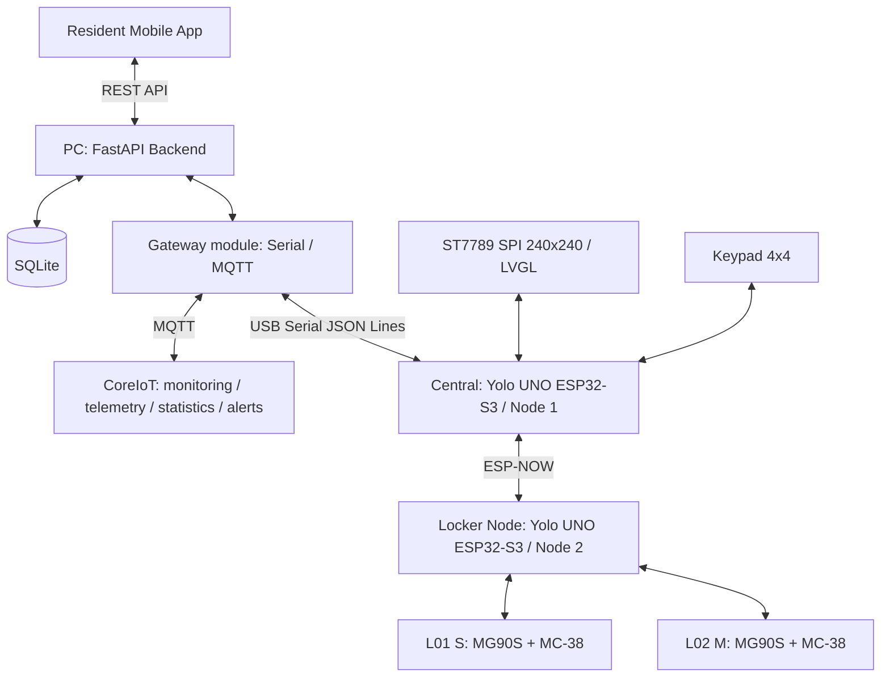

# Kiến trúc — Smart Parcel Locker MVP v2.1

> **Phạm vi branch:** feat/embedded kế thừa origin/feat/demo-simulator tại fa1c26b. Các nhận xét về Expo starter và firmware test bên dưới được quan sát ở workspace gốc feat/resident-mobile-app (firmware test còn untracked); các source đó không được đưa vào branch tài liệu này.

**Planned baseline.** Giữ cấu trúc backend hiện có; Backend/Gateway là các module trong cùng ứng dụng Python.

| Module | Trách nhiệm |
|---|---|
| Backend | Authentication, authorization, cư dân, allocation, transaction, audit, lưu dữ liệu |
| Gateway | Serial tới Central, MQTT tới CoreIoT; correlate/chuyển đổi transport; không tự quyết nghiệp vụ |
| Central | Thu keypad, hiển thị LVGL, chuyển request/response, định tuyến ESP-NOW; không trực tiếp điều khiển servo |
| Locker Node | Điều khiển hai servo, đọc MC-38, kiểm guard cửa, phản hồi; không cấp ngăn/xác thực cư dân |
| Mobile App | Login, xem kiện của mình, yêu cầu/hiển thị PIN và countdown |
| CoreIoT | Giám sát, telemetry, thống kê, cảnh báo; không tự mở tủ hoặc bỏ qua Backend |

Hai ESP32 không bắt buộc kết nối Internet. PC cung cấp đường REST/MQTT; không thêm board thứ ba hoặc HTTP server Gateway riêng.

## Luồng và ranh giới tin cậy

Gửi: kiosk → Backend kiểm phòng/SĐT/size → reserve + UNLOCK intent bền vững → Gateway → Central → Node → mở cửa/đặt hàng/đóng cửa/confirmation → LOCK → hoàn tất khi đủ evidence. Best-fit S→L01 rồi L02, M→L02; không chọn ngăn offline/lỗi/đang dùng/unknown.

Nhận v2.1: Mobile App đăng nhập/chọn kiện → Backend cấp PIN 6 số/30 giây → App hiển thị → nhập keypad → Central gửi Backend → Backend kiểm mã/owner/parcel/expiry/kiosk, tiêu thụ atomic với tạo giao dịch/intent → UNLOCK đúng ngăn → lấy hàng/đóng cửa/confirmation → LOCK và hoàn tất khi đủ evidence. Backend không phản hồi thì không mở.

Gateway là adapter tin cậy trong tiến trình; client HTTP không được gửi sensor evidence giả vào production. Chuyển COMMAND_RESULT/DOOR_EVENT sang DeviceEvent Phase 1 phải kiểm version, correlation, boot, sequence và freshness. STATUS chưa có mapper hoàn chỉnh cho heartbeat/reconcile. ACK không là kết quả servo; door CLOSED không chứng minh chốt gài cơ khí. Không có cảm biến kiện hàng hoặc vị trí chốt.

## Hiện trạng và tích hợp tiếp theo

Implemented: `backend.main`, `api`, `db`, `services`, `auth`, `state`, `devices`; `PendingDeviceAdapter` không sinh thành công giả. Simulator dùng development app/DB riêng, không phải kiến trúc production thứ hai. Production seed offline; chưa có Serial/MQTT adapter thật và không tự dispatch tại startup.

Phase 1 dùng kiosk tạo opaque code rồi cư dân gửi code qua API; luồng App cấp PIN → keypad nhập chưa có. Expo mới là starter. Firmware hiện có là test radio/button/MC-38/relay; Central test còn target `esp32dev`. Cần xử lý các khác biệt này trong công việc kế tiếp, không sửa source ở lần cập nhật tài liệu.

Nguồn Central qua USB laptop; Node qua USB riêng; servo qua 5V ngoài chung GND với Node. Hai ESP32 không cần dây GND nối nhau vì dùng ESP-NOW. [Pinout và gate phần cứng](../hardware/PINOUT.md), [contract](INTERFACES.md), [Phase 1](BACKEND_PHASE1.md).
