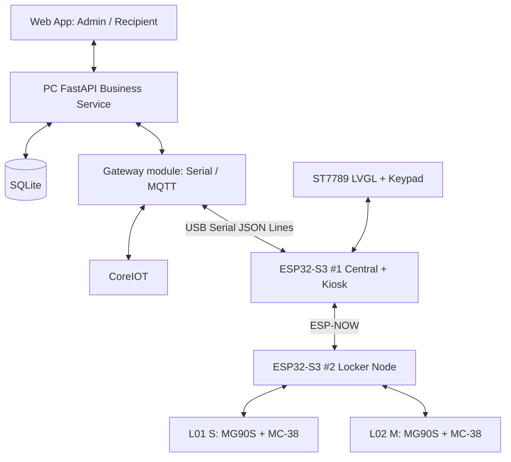

## Backend Phase 1 hiện hành

Một ứng dụng PC: `backend.main` + router `api`, database `db`, services/auth/state và boundary `devices` cho Gateway nội bộ. SQLite là nguồn sự thật, BEGIN IMMEDIATE reserve atomic, không có HTTP server Gateway riêng. 2 ESP32-S3: Central 1 và Locker Node 2 quản lý L01=S/L02=M, servo 5V + MC-38, không latch sensor. Chỉ hoàn tất bằng confirmation + door cycle + CLOSED mới + LOCK_APPLIED đúng phiên/command và không lỗi/offline/unknown; không tuyên bố khóa cơ khí. [Chi tiết](BACKEND_PHASE1.md). Cấu hình này ưu tiên hơn mô tả baseline cũ bên dưới.

---

# Kiến trúc — MVP v2.0

**PC chỉ chạy một ứng dụng Python:** Backend quyết định quyền, reserve, transaction, allocation, audit; Gateway chỉ làm transport không tự ghi nghiệp vụ. Central đọc kiosk và định tuyến; Locker Node chỉ điều khiển servo và đọc cửa, không phân bổ ngăn.

**Gửi:** kiosk → Backend kiểm tra phòng/SĐT/size → reserve atomic → lệnh UNLOCK → Node → người giao đặt hàng và đóng cửa → MC-38 báo door cycle → xác nhận thủ công → servo LOCK khi cửa CLOSED → STORED nếu điều kiện hợp lệ.

**Nhận:** Web App đăng nhập và kiểm chủ đơn → mã phiên kiosk TTL 30s → lệnh UNLOCK → lấy hàng → cửa OPEN→CLOSED → xác nhận → LOCK → hoàn tất nếu đủ bằng chứng nghiệp vụ.

**Giới hạn:** MC-38 chỉ nhận biết cửa; không thể xác nhận chốt cơ khí đã gài khi thiếu microswitch. Servo cần nguồn 5V bên ngoài, GND chung, đo dòng và tránh kẹt. Khi lỗi/reboot/offline không tự AVAILABLE và không phát lại lệnh UNLOCK mù.
