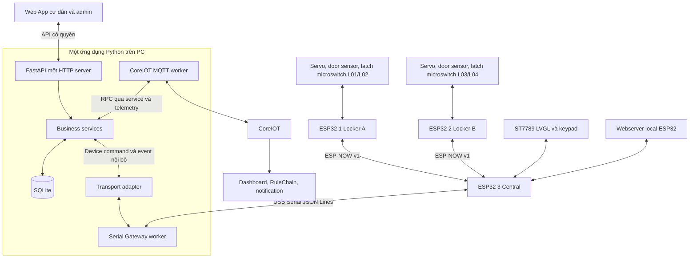
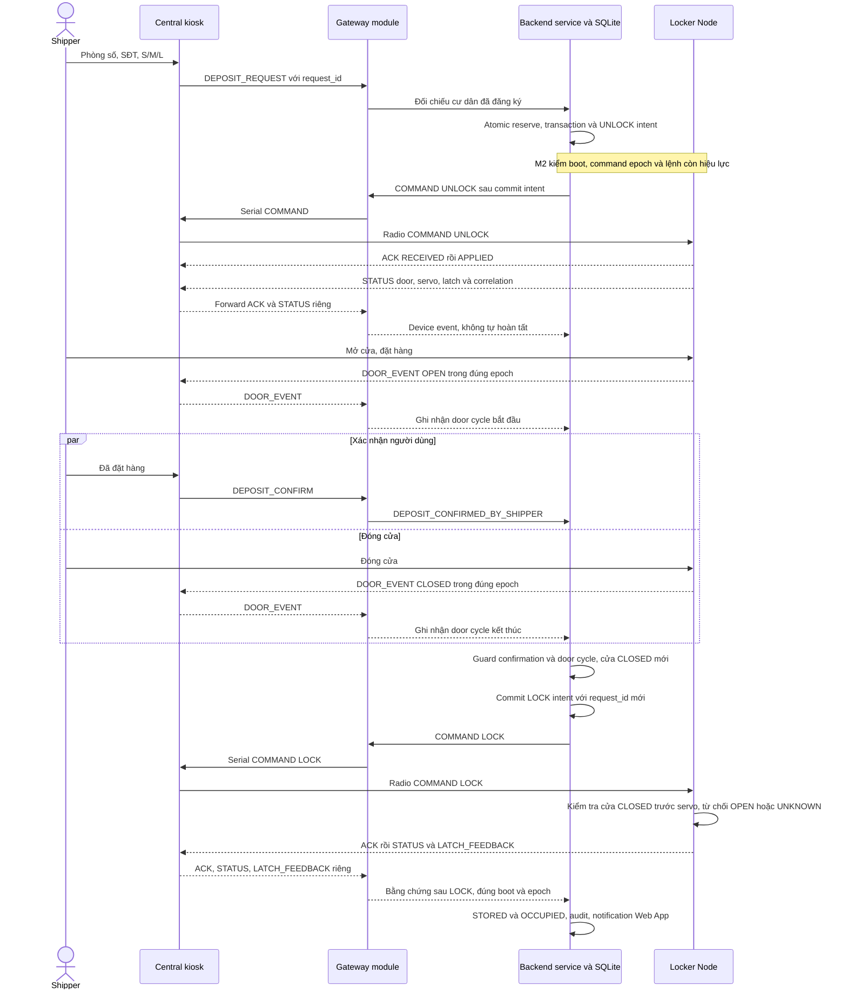
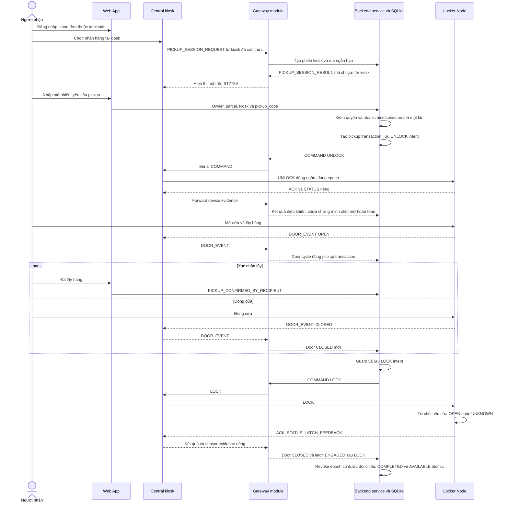

# Kiến trúc — baseline revision 1.3

Ngày 10/11/2026. Chính sách đã duyệt theo [PROJECT_SPEC](PROJECT_SPEC.md)/[DECISIONS](DECISIONS.md); encoding, tham số và recovery chi tiết còn review. Chưa có implementation hay evidence thiết bị. Đặc tả v1.2 gốc giữ làm lịch sử; revision 1.3 đang áp dụng.

## 1. Thành phần và quyền quyết định

| Thành phần | Owner | Trách nhiệm / giới hạn |
|---|---|---|
| ESP32 #1 Locker A | A | L01=S/L02=S; servo, door sensor và microswitch chốt từng ngăn; ACK/STATUS/event; không cấp đơn |
| ESP32 #2 Locker B | A | L03=M/L04=L, cùng firmware node khác cấu hình; không điều khiển ngăn ngoài mapping |
| ESP32 #3 Central | A | Một project PlatformIO/Arduino: ESP-NOW, Serial, LVGL/keypad, webserver và OTA; không giữ DB đơn chính |
| LVGL kiosk | A | Nhập phòng số/SĐT/size, xác nhận đặt, hiển thị mã phiên nhận và hướng dẫn; không phải Web App |
| ESP32 webserver T07 | A | Local giám sát/điều khiển có kiểm quyền, yêu cầu thay đổi khóa phải qua Backend service; không bypass |
| PC Backend module | B | FastAPI/API auth, business services, Best Fit, transactions, SQLite, intent/result/audit, Web App notification |
| PC Gateway module | B | Adapter transport, Serial/MQTT workers, parse/route/correlation/connection status; không ghi nghiệp vụ trực tiếp |
| Web App | B | Login, đơn/thông báo của tôi, nhập mã phiên kiosk, pickup/confirm; admin theo quyền; chỉ gọi FastAPI |
| CoreIOT | B | Template/dashboard, RPC có kiểm quyền, RuleChain, notification sự cố; không thay Backend |

## 2. Một ứng dụng Python trên PC

Backend và Gateway là module trong **cùng một ứng dụng Python + FastAPI + SQLite**, một HTTP server. API layer → business services → persistence; business services dùng device transport adapter; Serial Gateway và CoreIOT MQTT adapter phục vụ transport. Không microservices, broker nội bộ hay HTTP server thứ hai.

Serial/MQTT I/O chạy worker/task không chặn HTTP event loop. Worker chỉ phát device event/connection status/result tới service entry point qua cơ chế nội bộ có giới hạn; không tự reserve, ghi trạng thái đơn, hoàn tất hay dùng raw SQLite connection của domain. Async/threading model, capacity và timeout được review khi hiện thực; không cần sinh nhiều lớp/file ở M0. [INTERFACES](INTERFACES.md) định nghĩa submit/event/result contract tối thiểu.

Đường Webserver→Central→Serial→PC và CoreIOT→MQTT worker→service đều phải kiểm actor/quyền/state ở Backend trước actuator. Kiosk không xác thực shipper nhưng bản thân thiết bị/phiên kiosk cần được xác thực. Khi Backend không kết nối, không cấp UNLOCK mới; policy riêng cho cửa đã mở vẫn là D-08, không mặc định node tự khóa hay tự giải phóng.

## 3. Luồng gửi hàng và LOCK rõ ràng

Confirmation và đóng cửa có thể đến theo cả hai thứ tự; Backend giữ hai fact độc lập. Baseline chỉ phát LOCK khi đã có confirmation, đã thấy OPEN→CLOSED đúng phiên và cửa hiện CLOSED đủ mới. Node kiểm tra cửa lần nữa ngay trước điều khiển, không chỉ tin snapshot PC. Debounce/cơ khí/thời điểm đủ mới cần đo. Không tự LOCK từ timer/door edge trong firmware ngoài policy đã duyệt.

ACK/APPLIED chỉ nói lệnh điều khiển được áp dụng. Terminal command result và completion nghiệp vụ khác nhau: Backend cần STATUS mới khớp LOCK request/boot/epoch, servo LOCK_APPLIED, door CLOSED, latch ENGAGED và các fact người dùng/door cycle trước khi hoàn tất. Không nâng ACK thành sensor evidence.

## 4. Luồng nhận hàng với mã phiên kiosk

Mã phiên bind kiosk/phiên nhận rồi gắn owner/parcel/transaction khi redeem; một lần dùng, có TTL/giới hạn thử, không log secret. Retry cùng request được phép chỉ nhận kết quả cũ, không dùng mã mở lần khác. Mã có thể bị chia sẻ từ xa; không chứng minh vị trí tuyệt đối, không phải SMS OTP.

## 5. State và guard

Backend sở hữu business state; node sở hữu điều khiển và sensor thực. Door OPEN/CLOSED/UNKNOWN, servo command state và latch ENGAGED/NOT_ENGAGED/UNKNOWN độc lập. NOT_ENGAGED không có nghĩa đã xác minh vị trí mở hoàn toàn; không dùng lock_state=UNLOCKED như bản draft cũ.

| Chuyển state | Guard / side effect |
|---|---|
| AVAILABLE→RESERVED, đơn CREATED | Người nhận hợp lệ, ngăn đủ size/online/fresh; atomic reserve và tạo transaction |
| RESERVED→DEPOSITING, đơn DEPOSITING | UNLOCK intent bền vững, command được áp dụng/đối chiếu đúng phiên; ghi fact riêng, không coi cửa đã mở từ ACK |
| DEPOSITING→OCCUPIED, đơn STORED | Shipper confirmation + OPEN→CLOSED trong epoch + LOCK result và latch ENGAGED/door CLOSED mới; notification đúng người |
| OCCUPIED→COLLECTING, đơn PICKUP_PENDING | Auth/ownership + kiosk code atomic one-use + một pickup active; lưu intent trước send, xử lý pending trước ACK không mở phiên thứ hai |
| COLLECTING→AVAILABLE, đơn COMPLETED | Recipient confirmation + door cycle + LOCK result/sensor mới + không còn command epoch cũ hiệu lực; commit completion/release thống nhất |
| Lỗi, reboot, timeout, mất kết nối | Giữ ngăn không khả dụng UNKNOWN/FAULT, transaction pending/EXCEPTION theo D-08; không tự AVAILABLE |
| Admin maintenance/exception | Kiểm quyền/audit, không xóa active transaction; xác minh trạng thái và command epoch trước khi cho cấp lại |

DB reserve/transition/intent/audit phải được commit trước transport send; event quay về đi qua service validation. Không giữ transaction DB chờ radio. UNLOCK, LOCK, confirm và session request có request ID riêng, transaction ID liên kết phiên. Door/latch tự phát chỉ liên kết theo epoch/boot/sequence hợp lệ; snapshot CLOSED/ENGAGED cũ không tạo door cycle mới.

## 6. Recovery và khả năng tích hợp

M2 bắt buộc tối thiểu: mất ACK không mở lặp; ngắt/reconnect hoặc đổi boot dừng command pending; HELLO + GET_STATUS + đối chiếu SQLite/epoch; chưa xác định kết quả thì giữ UNKNOWN. Command hết hạn bị chặn trong queue và epoch bị revoke/expire ở node trước tái cấp. Thiết kế control session/lease trong INTERFACES là draft cần review/test, không claim đã phục hồi an toàn. BE-03 M4 mở rộng mọi điểm crash, admin maintenance và xác nhận sai.

D-08 còn mở cho mất Backend khi cửa đang mở, servo kẹt, không đủ điện, người dùng bỏ dở và cách admin kiểm tra ngăn có thể chứa hàng. Không có sensor hàng nên reconciliation không thể chứng minh ngăn trống. Không tự quyết định đóng/mở actuator ngoại tuyến ngoài guard cấm LOCK khi OPEN/UNKNOWN và cấm UNLOCK mới khi trạng thái chưa biết.

Central cần test cùng build: kiosk + ESP-NOW + Serial + webserver + OTA, RAM/flash/partition và coexistence Wi-Fi/radio (TC-33). PlatformIO/Arduino đã duyệt; board profile/GPIO/lib versions chưa chọn. OTA ưu tiên thử Central ở M1 nếu phần cứng/toolchain sẵn, phạm vi cuối D-10 còn mở.
