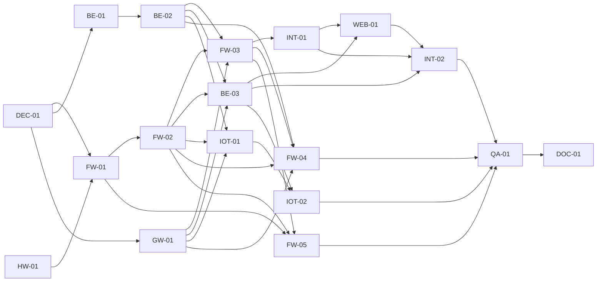

# Backlog Issue — baseline revision 1.3

Ngày 10/11/2026. **Xuất Markdown, chưa tạo Issue online.** Workspace chưa có Git remote/repository GitHub được cấu hình; không chọn tài khoản/repository thay nhóm. Các ID dưới đây là ID công việc nội bộ, không phải số Issue `#` trên GitHub. Milestone/labels cũng là đề xuất, chưa tạo từ xa. Chưa Issue triển khai nào được xác nhận DONE; policy mới đã duyệt được ghi trong DECISIONS, không phải kết quả test.

Owner: Member A = Embedded; Member B = Backend/IoT; Both = hai người cùng thực hiện/review. Dependencies dưới đây là Issue nội bộ; **Gate** là quyết định chưa chốt, không tự chuyển thành đã duyệt. Tiêu chí nghiệm thu chi tiết xem [TEST_PLAN](TEST_PLAN.md).

PC baseline: một ứng dụng Python/FastAPI/SQLite chứa Backend và Serial/MQTT Gateway; D-03/04/05/07 đã đóng chính sách. D/P parameter và wire review theo DECISIONS. M1 bench dùng subset v1, M2 nền/recovery tối thiểu, M3 một ngăn E2E. Không chờ cloud/OTA để bắt đầu HW-01 và BE-01 thiết kế.

## Bảy Issue ưu tiên ban đầu

### HW-01 — Single Locker Hardware Prototype

- **Description:** Một ngăn bench với servo/chốt, door sensor và microswitch latch; bao gồm sketch/test jig tối thiểu, không chờ FW-01. FR-07, NFR-08.
- **Owner:** Member A.
- **Dependencies:** Không có Issue tiên quyết; D-09 phần board/nguồn/wiring phải duyệt trước đấu điện; D-01 chỉ chặn kích thước/tủ cuối, D-03 loại feedback đã đóng. Không đợi cloud/OTA.
- **Deliverables:** BOM, sơ đồ nguồn/GPIO đúng board, cơ cấu thử, sketch/test jig và fixture M1 v1 nếu dùng transport; log riêng door/servo/latch, ảnh/video và số đo.
- **Acceptance Criteria:** Đề xuất 20 chu kỳ trong điều kiện tải đã duyệt; TC-28/30 phần bench; không LOCK khi cửa OPEN/UNKNOWN, không coi NOT_ENGAGED là mở hoàn toàn, không sensor hàng; không reset do tải trong bài thử. Không đòi firmware FW-01 đầy đủ.
- **Suggested Milestone:** M1.
- **Labels:** `hardware`, `prototype`, `priority:high`.

### FW-01 — Locker Node Firmware Foundation

- **Description:** Node PlatformIO/C++/Arduino dùng chung cho #1 L01/L02 và #2 L03/L04; tách driver servo/cửa/microswitch khỏi transport/domain. FR-05/07, NFR-01/08.
- **Owner:** Member A.
- **Dependencies:** HW-01, DEC-01 phần M1; P-02/D-09 board/revision/GPIO/lib version cần xác minh, D-03 microswitch đã đóng.
- **Deliverables:** Project build được đúng target đã duyệt, cấu hình mapping cố định, driver/sensor state, fixture v1 M1 và hướng dẫn build/upload đã chạy.
- **Acceptance Criteria:** Node chỉ điều khiển ngăn của mình; door/servo/latch độc lập, LOCK có guard door CLOSED; boot không tự AVAILABLE/grant hợp lệ; TC-28/30 PASS sau hiện thực.
- **Suggested Milestone:** M2.
- **Labels:** `firmware`, `locker-node`, `priority:high`.

### FW-02 — ESP-NOW Communication

- **Description:** ESP-NOW v1 từ subset M1 tới M2, source/target riêng, ACK không sensor và STATUS/correlation riêng; recovery tối thiểu trước INT-01. FR-05, NFR-02/03.
- **Owner:** Member A.
- **Dependencies:** FW-01, DEC-01 phần wire/session M2; P-01/P-05/D-06 và D-08 phần recovery tối thiểu.
- **Deliverables:** Encoder/decoder/peer route, boot/sequence/epoch, dedup, heartbeat/STATUS freshness, control-session invalidation draft đã review, fixture round-trip và log radio.
- **Acceptance Criteria:** TC-13/24/25/26/27/34 phần radio PASS; COMMAND 3→1/2 và response 1/2→3; lost ACK không chạy lại servo, expired epoch không mở phiên mới, STATUS không lấy từ ACK; reboot/reconnect giữ UNKNOWN tới đối chiếu.
- **Suggested Milestone:** M2.
- **Labels:** `firmware`, `esp-now`, `protocol`, `priority:high`.

### BE-01 — Database Schema & Locker Allocation

- **Description:** Thiết kế M1 rồi hiện thực M2 SQLite/Best Fit cho L01=S/L02=S/L03=M/L04=L, cư dân admin tạo trước, intent/result và audit. FR-02/03/04/12.
- **Owner:** Member B.
- **Dependencies:** DEC-01 phần dữ liệu/fixture; thiết kế giả không đợi cm D-01/cloud/OTA. P-04 chỉ tie-break còn review; P-03 normalization/uniqueness/auth data và D-06/D-08 phần persistence tối thiểu trước implementation.
- **Deliverables:** M1: ER/schema design và Best Fit/test matrix, fixture/mock transport giả. M2: DDL/migration/init có version, allocator atomic, active operation constraints, durable command intent/idempotency/result/audit và policy dữ liệu.
- **Acceptance Criteria:** Thiết kế giữ room_code chuỗi số, đối chiếu đúng một cư dân, không auto-create/password phòng-SĐT. Khi hiện thực: TC-02/03/19…22/29/34 phần DB PASS; một active reservation/ngăn, lưu size, intent commit trước send và không auto AVAILABLE sau restart.
- **Suggested Milestone:** M1 thiết kế/fixture; M2 implementation.
- **Labels:** `backend`, `sqlite`, `allocation`, `priority:high`.

### BE-02 — Backend API Foundation

- **Description:** FastAPI API/auth/business services trong một Python app chung Gateway; identity/kiosk pickup code, state machine và recovery tối thiểu M2. FR-01/02/06/08/09/10/12, NFR-01/03/04.
- **Owner:** Member B.
- **Dependencies:** BE-01, DEC-01 phần M2; P-02 versions, P-03 hash/session/format/code TTL-attempts/provisioning, D-06/D-08 tối thiểu/P-05. D-03/04/05 policy đã duyệt.
- **Deliverables:** Một FastAPI server, API/session design, atomic code redemption/ownership/idempotency, domain service ingress cho Gateway, command intent/result và mock transport; fixture/test/README.
- **Acceptance Criteria:** TC-04…11/23/24/29/31/32/34/35 phần API/service PASS; mã sai/hết hạn/used/session khác không mở; confirmation trước/sau cửa đều được; completion cần door cycle+LOCK+CLOSED+ENGAGED mới; lost ACK/disconnect không auto AVAILABLE; worker không mutate domain.
- **Suggested Milestone:** M2.
- **Labels:** `backend`, `api`, `security`, `priority:high`.

### GW-01 — Serial Communication Foundation

- **Description:** Serial Gateway và adapter nội bộ cùng ứng dụng FastAPI, không server/broker riêng; worker Serial/MQTT không chặn HTTP. FR-15, NFR-01/02/03.
- **Owner:** Member B.
- **Dependencies:** DEC-01 phần contract M1/M2; USB Serial D-07 đã đóng, P-01/P-03/P-05 và D-06/D-08 tối thiểu còn review. Fake peer cho phép phát triển độc lập với radio thật.
- **Deliverables:** Bounded JSON Lines parser, logical src/dst và mapping radio/JSON, handshake/reconnect, submit/event/connection/transport-result/invalidate contract, worker lifecycle/backpressure và fixture giả.
- **Acceptance Criteria:** TC-25/26/27/34/35 phần transport PASS; ACK không thêm sensor; giữ boot/sequence/epoch/correlation; line dở/sai không thực thi; QUEUED không phải node ACK; queue cũ không replay, không log code/SĐT, không ghi DB nghiệp vụ trực tiếp.
- **Suggested Milestone:** M2.
- **Labels:** `gateway`, `serial`, `protocol`, `priority:high`.

### INT-01 — One-Locker End-to-End Integration

- **Description:** Một ngăn E2E với kiosk→một app PC→node, cư dân/admin seed, login và mã kiosk one-use; chưa cần full Web App. FR-01…10/12, NFR-02/03/04/08.
- **Owner:** Both.
- **Dependencies:** HW-01, FW-01, FW-02, FW-03, BE-01, BE-02, GW-01; contract/policy D-06/D-08 tối thiểu/P-01/P-03/P-05 phải duyệt và test. Full recovery M4 không phải dependency của mốc một ngăn.
- **Deliverables:** Demo gửi–nhận, confirmation/door cycle/LOCK/latch thật, intent/result DB/audit sạch, loss/reconnect và mã kiosk invalidation evidence.
- **Acceptance Criteria:** TC-01/04/05/06/08/09/10/11/25/31/32/34 phần một ngăn PASS; cả hai thứ tự confirm/CLOSED, mã không reuse, lỗi tối thiểu không mở lặp/auto AVAILABLE; ACK không đủ completion; không tuyên bố parcel sensing; A/B review.
- **Suggested Milestone:** M3.
- **Labels:** `integration`, `e2e`, `priority:high`.

## Issue hỗ trợ và hoàn thiện

### DEC-01 — Review Baseline Contracts & Setup Gates

- **Description:** Đồng bộ approved revision 1.3, review phần M1 rồi wire/auth/recovery M2 theo từng gate; không yêu cầu mọi cloud/OTA hoàn tất trước prototype/design.
- **Owner:** Both.
- **Dependencies:** Không có Issue tiên quyết; policy D-03/04/05/07, PC/framework/mapping đã approved; D-01/06/08/09/10 và P-01…05 phần còn mở có owner.
- **Deliverables:** Decision/contract review theo phần, M1 serializer/sensor fixtures, schema/identity/session design inputs, board/tool/version evidence và danh sách gate chưa mở.
- **Acceptance Criteria:** Ghi nguồn approval thật, không giả chữ ký; M1 có đúng door/latch và LOCK guard, M2 có src/dst/ACK-STATUS/epoch/intent/session-code/freshness/recovery tối thiểu. Thiếu số đo/wire review vẫn mở; không dùng cloud/OTA gate để chặn mọi việc HW-01/BE-01.
- **Suggested Milestone:** M1, review M2 theo gate.
- **Labels:** `architecture`, `decision`, `setup`, `priority:high`.

### FW-03 — Kiosk LVGL & Keypad Workflow

- **Description:** Central LVGL/keypad: phòng số/SĐT/size, xem lại/nâng size, confirmation và nhận hàng hiển thị mã phiên ST7789. FR-01/06/18, hỗ trợ FR-09.
- **Owner:** Member A.
- **Dependencies:** FW-02, BE-02, GW-01 cho integration; UI fixture/spike M1 không cần chờ tất cả. D-01 bảng cm thật, P-03 session-code params, D-09/P-02 display/keypad/library còn gate.
- **Deliverables:** Module kiosk trong firmware Central, form/chuyển trạng thái và code-display flow có expiry/error handling, fixture giả, video thiết bị.
- **Acceptance Criteria:** TC-01/04/05/16C/19/31/32 PASS phần UI; phòng chỉ số, confirmation trước/sau đóng đều được; không show hoàn tất từ ACK; không log mã/SĐT; không dùng cm mẫu như chính thức.
- **Suggested Milestone:** M2; thử riêng UI M1 nếu sẵn.
- **Labels:** `firmware`, `lvgl`, `kiosk`.

### BE-03 — Maintenance & Transaction Reconciliation

- **Description:** Full reconciliation/maintenance/admin cho crash, người dùng bỏ dở/xác nhận sai và chính sách mất Backend khi cửa mở; mở rộng recovery tối thiểu M2, không thay thế nó. FR-11/12/13, NFR-03/06.
- **Owner:** Member B.
- **Dependencies:** BE-02, FW-02, GW-01; D-06/D-08/P-05 full recovery/admin policy còn mở; D-03 latch đã chốt.
- **Deliverables:** Full crash/exception matrix, admin vào/ra maintenance có audit, reconcile command epoch và sensor, xử lý manual inspection vì không sensor hàng.
- **Acceptance Criteria:** TC-14/15/26/28/30/34 phần full matrix PASS; không xóa transaction, không AVAILABLE từ timeout/DB cũ, không LOCK khi OPEN; policy offline-open chưa duyệt thì không nghiệm thu nhánh đó.
- **Suggested Milestone:** M4.
- **Labels:** `backend`, `recovery`, `maintenance`, `priority:high`.

### WEB-01 — Recipient & Admin Web App

- **Description:** Web App cư dân/admin dùng cùng FastAPI API: login, đơn/notification của tôi, nhập mã phiên kiosk, pickup/confirm và maintenance. FR-08/09/10/13.
- **Owner:** Member B.
- **Dependencies:** BE-02, BE-03, INT-01 cho nghiệm thu full; UI fixture có thể sớm. P-03 auth/code/session details và P-02 frontend framework còn review; D-04/D-05 chính sách đã đóng.
- **Deliverables:** UI API thực, mã kiosk còn hạn/one-use và lỗi/attempt budget, pending/error/sensor distinction, admin và test quyền.
- **Acceptance Criteria:** TC-08/09/10/11/15/24/31/32 qua browser PASS; mã không thay ownership, duplicate không mở thêm; không gọi 202/ACK là đã mở; ghi rõ code có thể chia sẻ từ xa, không tuyệt đối chứng minh vị trí.
- **Suggested Milestone:** M4.
- **Labels:** `web-app`, `auth`, `notification`.

### INT-02 — Four-Locker Best-Fit Integration

- **Description:** Nhân đủ 4 ngăn, 2 node, mapping L01/L02=S, L03=M, L04=L; Web App/recovery/admin và best-fit tích hợp. FR-03/04/05/11/13.
- **Owner:** Both.
- **Dependencies:** INT-01, WEB-01, BE-03, HW-01; D-01/D-09 phần tủ/nguồn và P-04 tie-break cần duyệt, mapping đã cố định.
- **Deliverables:** Tủ bốn servo/bốn door sensor/bốn latch microswitch, sơ đồ/mapping, concurrency/nâng size/fault report và video.
- **Acceptance Criteria:** TC-02/03/13/15/19…22/28/30 PASS phù hợp thiết bị; lỗi/bảo trì/offline/active transaction bị loại, không cấp trùng; đúng node/ngăn và không mở phiên mới bởi command cũ.
- **Suggested Milestone:** M4.
- **Labels:** `integration`, `hardware`, `allocation`.

### FW-04 — ESP32 Local Webserver (T07)

- **Description:** ESP32 local webserver T07 trong cùng Central firmware, request có quyền đi qua Backend PC, không server thay thế Web App. FR-14, NFR-04.
- **Owner:** Member A.
- **Dependencies:** FW-02, FW-03, BE-02, GW-01 cho nghiệm thu combined build; P-03 auth/local route và D-08 offline policy còn mở.
- **Deliverables:** Module webserver thực trên ESP32, auth/routing, local UI, evidence T07 và combined-build report.
- **Acceptance Criteria:** TC-16A/27/33 PASS; user không quyền bị từ chối, không direct servo bypass; kiosk/radio/Serial/webserver cùng hoạt động, secrets không nằm source.
- **Suggested Milestone:** M5.
- **Labels:** `firmware`, `webserver`, `T07`, `security`.

### FW-05 — OTA Firmware Demonstration (T14)

- **Description:** Ưu tiên thử OTA Central sớm; nghiệm thu scope cuối sau đối chiếu T14 với giảng viên, không loại mở rộng node. FR-17, NFR-03.
- **Owner:** Member A.
- **Dependencies:** FW-01, FW-02, FW-03 cho nghiệm thu cuối; early OTA spike M1 độc lập nếu board/toolchain sẵn. D-10/P-02/P-03 partition/memory/coexistence/update policy còn review.
- **Deliverables:** Hai version/build/checksum, Central OTA spike/evidence khi đủ điều kiện, final scope đã đối chiếu, update/recovery guide và TC-33 combined-load evidence.
- **Acceptance Criteria:** TC-16B/33 PASS trên target đã duyệt; sau reboot kiosk/radio/Serial/cửa/latch còn đúng, pending không auto AVAILABLE; fail update/active transaction theo policy. Không tuyên bố chỉ Central chắc đủ 2 điểm.
- **Suggested Milestone:** M5; kiểm chứng riêng có điều kiện từ M1.
- **Labels:** `firmware`, `ota`, `T14`.

### IOT-01 — CoreIOT Dashboard & Bidirectional Gateway

- **Description:** CoreIOT telemetry/RPC qua MQTT worker trong app PC, dashboard/template T08/T11; service Backend kiểm mọi điều khiển. FR-15/16, NFR-01/04/05.
- **Owner:** Member B.
- **Dependencies:** GW-01, BE-02, FW-02; tenant/device access và P-03 RPC role/topic/provisioning còn gate, không chặn M1 hardware/DB design.
- **Deliverables:** Mapping/topic/RPC/auth design, adapter MQTT không chặn HTTP, dashboard/template export sạch và log hai chiều.
- **Acceptance Criteria:** TC-17A/29/35 PASS; telemetry door/latch đúng, RPC trái quyền không tới node, ACK/STATUS tách; không phòng/SĐT/code/token công khai, không worker tự chuyển business state.
- **Suggested Milestone:** M5.
- **Labels:** `coreiot`, `gateway`, `T08`, `T11`.

### IOT-02 — RuleChain & Incident Notifications

- **Description:** RuleChain/notification sự cố cửa/offline/sai lệch, khác Web App notification đơn; không thêm TinyML. FR-11/16.
- **Owner:** Member B.
- **Dependencies:** IOT-01, BE-03; D-06/P-05 ngưỡng/freshness và anti-duplicate notification cần review.
- **Deliverables:** RuleChain/export notification sạch, ngưỡng đã duyệt, kịch bản kích lỗi và evidence thật T12/T13.
- **Acceptance Criteria:** TC-12/17B PASS; notification thật đúng ngăn/timestamp và ngưỡng, không dùng telemetry cũ như mới; số lần gửi theo policy đã duyệt.
- **Suggested Milestone:** M5.
- **Labels:** `coreiot`, `rulechain`, `notification`, `T12`, `T13`.

### QA-01 — System Acceptance & Fault Injection

- **Description:** Acceptance toàn Must Have, recovery/mã kiosk/door cycle/latch và Central cùng build; không coi documentation QA là test chức năng.
- **Owner:** Both.
- **Dependencies:** INT-02, BE-03, FW-04, FW-05, IOT-02.
- **Deliverables:** Kết quả TC-01…35 và tiểu mục, HIL/evidence đã khử secret, số liệu đo, danh sách lỗi và rerun hợp lý, self-assessment công nghệ input.
- **Acceptance Criteria:** Must Have PASS trên target, không biến NOT RUN/BLOCKED thành PASS; TC-18 giới hạn sensor, TC-31 code, TC-32 thứ tự user/cửa, TC-33 combined Central, TC-34/35 recovery/adapter có evidence; A/B review.
- **Suggested Milestone:** M6.
- **Labels:** `test`, `e2e`, `reliability`, `priority:high`.

### DOC-01 — Final Report & Reproducible Demo

- **Description:** Báo cáo/demo/hướng dẫn tái lập theo thông báo môn, phản ánh đúng phần kế thừa/tự làm và phạm vi AI; không tự tính điểm từ kế hoạch.
- **Owner:** Both.
- **Dependencies:** QA-01.
- **Deliverables:** PDF theo mẫu tên [Mã lớp]_[Mã nhóm]_BaoCaoIoT.pdf; bảng tự đánh giá công nghệ và phân công; ≥5 tham khảo/trích phần kế thừa; khai báo AI; README đã kiểm chứng; GitHub access/lịch sử commit cả A/B; video demo khuyến nghị 5–10 phút.
- **Acceptance Criteria:** Người còn lại tái lập được setup/build/run; T06/T07/T08/T11/T12/T13/T14/N03 có code/evidence thật và trạng thái đúng mức; đáp ứng PDF/self-assessment/contribution/AI/reference/video/GitHub theo thông báo; T14 scope đối chiếu giảng viên, không hứa điểm; không secrets/PII.
- **Suggested Milestone:** M6.
- **Labels:** `documentation`, `report`, `demo`.

## Ánh xạ Work Package từ v1.2

| WP | Issue |
|---|---|
| WP-01 — cơ khí/điện | HW-01, INT-02 |
| WP-02 — Locker Node | FW-01, FW-02 |
| WP-03 — kiosk | FW-03 |
| WP-04 — webserver/OTA | FW-04, FW-05 |
| WP-05 — Gateway/CoreIOT | GW-01, IOT-01 |
| WP-06 — Backend/SQLite | BE-01, BE-02, BE-03 |
| WP-07 — Web App | WEB-01 |
| WP-08 — RuleChain/notification/maintenance | IOT-02, BE-03 |
| WP-09 — tích hợp/đo/báo cáo | DEC-01, INT-01, INT-02, QA-01, DOC-01 |

## Đường dependency chính

Sơ đồ rút gọn các cạnh bắc cầu; danh sách Dependencies của từng Issue là nguồn đầy đủ. Decisions/gate không thể biểu diễn chỉ bằng cạnh Issue; phải đọc DECISIONS trước khi bắt đầu phần bị chặn.
